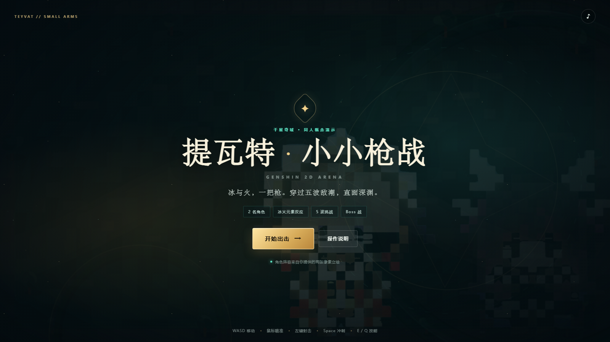
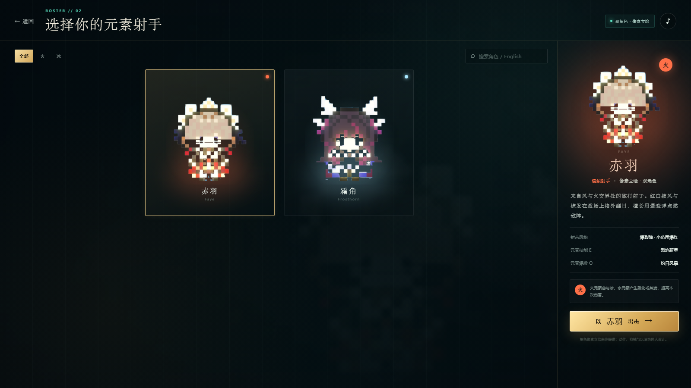
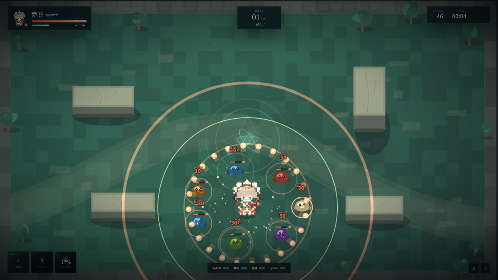
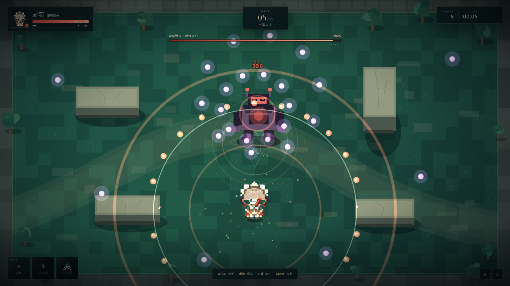

# 提瓦特 · 小小枪战 2D

一款使用 **HTML5 Canvas + 原生 JavaScript** 制作的俯视角元素枪战小游戏。



## 立即运行

1. 双击 `启动游戏.bat`
2. 或者直接用 Chrome / Edge 打开 `index.html`
3. 手机游玩时请横屏；竖屏会显示旋转提示

游戏完全离线运行，无外部依赖、无需安装。
## 操作

| 操作 | PC | 手机 / 平板 |
|---|---|---|
| 移动 | `WASD` / 方向键 | 左半屏虚拟摇杆 |
| 瞄准 | 鼠标 | 右半屏拖动 |
| 射击 | 按住鼠标左键 | 右半屏拖动时自动射击 |
| 冲刺 | `Space` | 右下角「冲刺」按钮 |
| 元素技能 | `E` | 右下角 `E` 按钮 |
| 元素爆发 | `Q` | 右下角 `Q` 按钮 |
| 暂停 | `P` / `Esc` | 右下角暂停按钮 |

## 角色

| 角色 | 元素 | 战斗定位 | 技能 | 爆发 |
|---|---|---|---|---|
| 赤羽 | 火 | 爆裂射手 | 烈焰新星 | 灼日风暴 |
| 霜角 | 冰 | 霜华狙击 | 霜华爆发 | 凛冬冰雨 |

角色立绘来自你提供的两张图片，已处理为透明背景，并保留了原图的像素质感与发光边缘。

## 玩法内容

- 5 波敌人，逐步加入近战史莱姆、远程弓手、重装精英、深渊法师
- 最终 Boss「深渊遗迹 · 侵蚀核心」：三阶段，弹幕、召唤眷属、加速攻击
- 火 / 冰元素附着与 **融化反应**
- 每个波次结束三选一强化：
  - 伤害、攻速、移速、最大生命
  - 元素反应强化
  - 冲刺冷却、暴击率、护盾、拾取范围
- 血包、能量球、星辉拾取物
- 程序化像素竞技场、粒子、伤害数字、元素光效
- 程序化 WebAudio 音效与背景音乐，无外部音频文件

## 截图

| 角色选择 | 战斗 |
|---|---|
|  |  |



## 文件结构

```text
genshin-2d-gunfight/
├─ index.html                  页面与 UI
├─ 启动游戏.bat                Windows 一键启动
├─ css/style.css               界面样式
├─ js/data.js                  两名角色与元素数据
├─ js/sprites.js               角色图像、像素精灵、场景绘制
├─ js/audio.js                 程序化音效与 BGM
├─ js/game.js                  战斗、波次、Boss、强化、UI 逻辑
├─ assets/characters/          处理后的透明角色立绘
└─ screenshots/                预览截图
```

## 说明

- 浏览器需要支持 Canvas 2D、WebAudio 和 Pointer Events；推荐最新版 Chrome / Edge。
- 第一次点击页面后才会启动声音，这是浏览器的自动播放限制。
- 若角色图不显示，请确认 `assets/characters/` 目录与 `index.html` 保持相对位置不变。
- 本作是同人演示项目，非《原神》官方作品，请勿用于商业发行。
